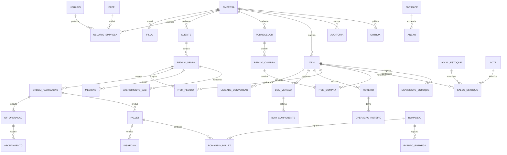

# Arquitetura alvo incremental

## Princípios

- Monólito modular no App Router; manter rotas atuais como adaptadores durante a migração.
- Domínios: identidade/tenancy, cadastro, compras, estoque, PCP, qualidade, vendas/logística, financeiro, manutenção e IA.
- Cada domínio separa regras puras, casos de uso, persistência e UI. Não mover `app/` em massa.
- APIs novas sob `/api/v1`; manter contratos atuais e encaminhar para os mesmos serviços até descontinuação explícita.
- Zod na borda HTTP; RBAC e escopo empresa/filial no caso de uso e no repositório.
- Postgres/Neon como fonte transacional; avaliar Drizzle para queries tipadas e migrations versionadas. A adoção deve ser incremental e não coexistir como segundo dono do schema.
- Evento de domínio e registro outbox na mesma transação da escrita; worker idempotente para envio/retentativa.
- Arquivos em storage privado S3 compatível ou Vercel Blob, com metadados no banco, URL curta assinada e validação de tipo/tamanho.
- IA consulta somente ferramentas tipadas; escrita operacional requer confirmação explícita do usuário.

## Modelo conceitual

Cadastros globais (ex.: unidade de medida) podem ser compartilhados. Cadastros e movimentos operacionais devem carregar escopo de empresa/filial, ou derivá-lo por FK obrigatória em transações; queries não podem inferir escopo do cliente.

## Jobs e deploy

Cron da Vercel pode despachar itens outbox pequenos. MRP, extração documental e relatórios demorados devem usar worker/fila externa com retry, dead-letter, idempotency key e observabilidade. CI deve executar `npm ci`, lint, tipos, testes e build; migrations só em etapa controlada de ambiente de homologação.
